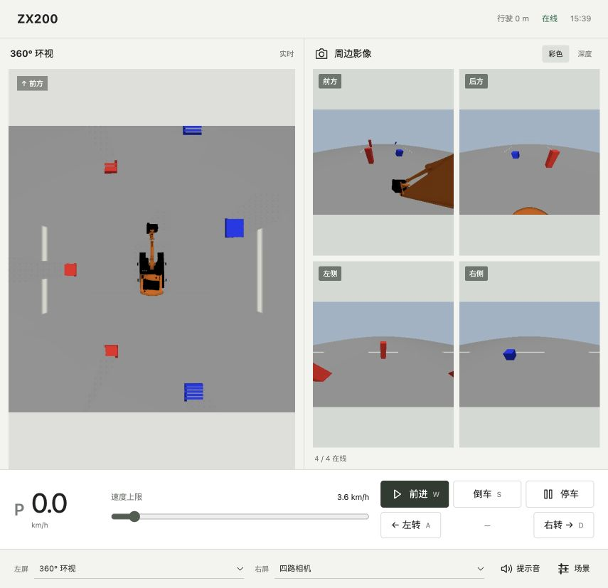
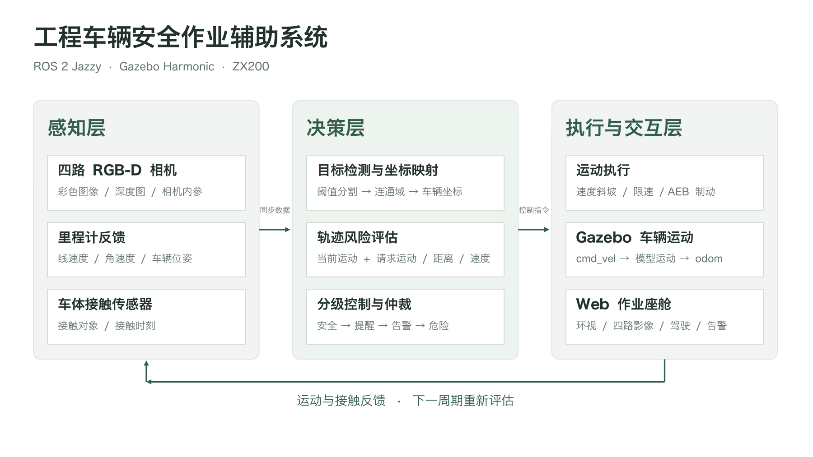

<div align="center">

# Excavator Safety

**ROS 2 + Gazebo 工程车辆安全作业辅助仿真**

RGB-D 周边感知 · 鸟瞰环视 · 路径风险评估 · 自动紧急制动

[](https://github.com/Kevinn6366/excavator-safety-ros2/actions/workflows/tests.yml)
[](LICENSE)
[](https://docs.ros.org/en/jazzy/)
[](https://gazebosim.org/docs/harmonic/)

[快速开始](#快速开始) · [系统架构](docs/ARCHITECTURE.md) · [运行指南](docs/USAGE.md) · [开发贡献](CONTRIBUTING.md)

</div>



## 项目简介

本项目以 ZX200 挖掘机为对象，使用四路 RGB-D 相机检测周边人员与障碍物，结合里程计反馈评估行驶路径风险，联动分级预警、限速与 AEB。Web 座舱提供环视、相机影像、驾驶控制和随机场景配置。

目标位置来自相机图像与深度检测；场景预设坐标用于布局及独立评价。系统采用颜色几何目标、固定动臂姿态和速度斜坡制动模型，适用于智能系统课程与算法仿真实验。

## 核心能力

| 能力 | 实现 |
|---|---|
| 周边感知 | 四路 RGB-D、HSV 分割、连通域分析、深度反投影与三维定位 |
| 鸟瞰环视 | 基于深度的正交投影，配合 ZX200 车顶素材 |
| 主动防护 | 当前运动与驾驶请求双轨迹评估、四级预警、方向相关 AEB |
| 驾驶交互 | 前进、倒车、转向、线性加减速及制动后的反向脱离 |
| 场景管理 | 仿真启停、复位、最多 80 个随机目标和接触告警 |
| 实验验证 | 可重复场景、标定扰动、单元测试与 Gazebo 集成测试 |

## 快速开始

### 1. 准备环境

已验证环境：**Ubuntu 24.04 ARM64 · ROS 2 Jazzy · Gazebo Harmonic**。

先安装 [ROS 2 Jazzy](https://docs.ros.org/en/jazzy/Installation/Ubuntu-Install-Debs.html) 和 [Gazebo Harmonic](https://gazebosim.org/docs/harmonic/install_ubuntu/)，然后安装依赖：

```bash
sudo apt update
sudo apt install ros-jazzy-ros-gz ros-jazzy-cv-bridge \
  ros-jazzy-message-filters ros-jazzy-sensor-msgs-py \
  python3-opencv python3-numpy python3-scipy python3-yaml
```

### 2. 获取模型并启动

```bash
git clone https://github.com/Kevinn6366/excavator-safety-ros2.git
cd excavator-safety-ros2
source scripts/env.sh
python3 -m excavator_safety.assets.download
./scripts/start.sh --gui
```

在浏览器打开 **<http://localhost:8080>**。远程访问时使用 Linux 主机 IP。

模型下载固定上游提交并校验已有文件；启动脚本自动生成 SDF 世界与桥接配置。Web 使用 Python 标准库服务，无需 Node.js 构建。完整仿真使用能够导入 ROS 包的系统 Python，无需执行 pip 安装。

### 3. 驾驶与停止

| 操作 | 功能 |
|---|---|
| W / S | 按住前进 / 倒车 |
| A / D | 按住转向，可与 W / S 组合 |
| 松开 W / S | 线性滑行减速 |
| 空格 | 主动制动 |
| 场景面板 | 随机布局、复位和仿真启停 |

```bash
./scripts/stop.sh
```

停止仿真后网页保持运行，以便重新启动。显示会话、软件渲染、端口配置与常见问题见 [运行指南](docs/USAGE.md)。

## 系统架构



算法层独立于 ROS；ROS 节点负责消息适配，仿真包负责进程与场景生命周期。检测结果经坐标变换进入风险评估，控制指令驱动 Gazebo，里程计和接触消息形成反馈。

详细包职责、依赖关系及数据路径见 [架构说明](docs/ARCHITECTURE.md)。

## 仓库结构

```text
src/excavator_safety/
├── perception/       # 坐标几何、目标检测
├── control/          # 风险评估、状态机与速度控制
├── visualization/    # 鸟瞰与全景图像算法
├── ros/              # ROS 安全节点与 Web 服务适配
├── simulation/       # 仿真生命周期与进程清理
├── assets/           # 模型下载、导入、场景生成
├── evaluation/       # 随机场景、指标与驾驶评价
├── config.py         # 公共传感器和车辆参数
└── paths.py          # 统一资源路径
frontend/             # 网页与静态素材
scripts/              # 环境、启动和停止入口
tests/
├── unit/             # 无需 ROS 的算法与结构测试
└── integration/      # 需要运行仿真的端到端测试
docs/                 # 架构、运行、验证与迁移说明
```

`vendor/`、`models/`、`worlds/`、`data/`、`history/`、`logs/` 和 `evidence/` 均为下载或运行生成目录，不纳入版本控制。

## 测试与实验结果

已安装上述算法依赖后：

```bash
source scripts/env.sh
python3 -m unittest discover -s tests/unit -v
```

Gazebo 场景评价与动态测试的命令见 [运行指南](docs/USAGE.md#实验复现)。GitHub Actions 在每次推送和 Pull Request 上运行单元测试。

课程实验中，24 组场景全部检出，保存 480 帧；单帧处理耗时 P95 为 33.41 ms，响应观测时差 P95 为 0.404 s。后者包含场景服务和状态采样开销。评价口径与结果见 [验证说明](docs/VALIDATION.md) 和 [指标原始摘要](docs/metrics.json)。

## 参与开发

欢迎通过 Issue 报告问题，或通过 Pull Request 提交改进。环境配置、代码规范与验证要求见 [CONTRIBUTING.md](CONTRIBUTING.md)。从旧版根目录脚本迁移，请参阅 [迁移指南](docs/MIGRATION.md)。

## 许可证与致谢

原创代码采用 [Apache-2.0](LICENSE)。ZX200 模型来自 [pwri-opera/OperaSim-AGX](https://github.com/pwri-opera/OperaSim-AGX)，固定提交 `1b401d7cc97e11ad6a1c6807562b99c756366e4e`。第三方资产、派生车顶图与适配说明见 [THIRD_PARTY_NOTICES.md](THIRD_PARTY_NOTICES.md)。
