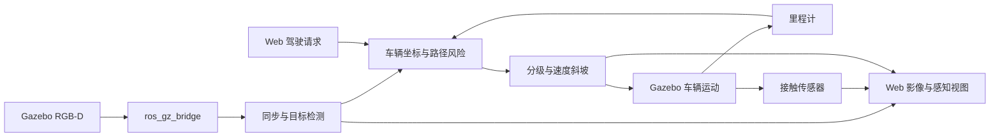

# 系统架构

## 包边界

| 包 | 职责 | 主要依赖 |
|---|---|---|
| `perception` | 相机外参、深度反投影、车体净空与 HSV 检测 | NumPy、OpenCV、公共参数 |
| `control` | 轨迹扫掠、风险等级、迟滞与双向速度斜坡 | NumPy、几何计算 |
| `visualization` | RGB-D 鸟瞰与相机全景算法 | 感知几何、OpenCV |
| `ros` | 消息订阅同步、控制发布、HTTP 服务 | ROS 2、上述算法包 |
| `simulation` | 仿真启动、停止、复位及随机目标布置 | Linux 进程、Gazebo 接口 |
| `assets` | 固定版本模型下载、URDF 适配、SDF 生成与车顶渲染 | NumPy、SciPy、PyYAML |
| `evaluation` | 独立场景布局、数据统计与运行验证 | 感知算法、ROS 2 |

算法模块不导入 ROS。测试脚本中的场景真值只用于评价，不输入感知算法。

## 数据流

## 路径和运行约定

采用 `src` 布局，以 `excavator_safety` 为统一导入命名空间。`paths.py` 根据源码位置确定仓库根目录，也可通过 `EXCAVATOR_SAFETY_ROOT` 显式指定。相机数据、模型和网页资源不依赖调用者当前目录。

仿真以源码 checkout 方式运行。`scripts/env.sh` 设置源码搜索路径，`scripts/start.sh` 切换到仓库根目录，随后用 `python3 -m ...` 启动模块。完整模拟器需要仓库中的 `frontend/` 和 `scripts/`；单独安装 wheel 不包含这些运行资产。

进程清理同时检查工作目录、Gazebo partition 和进程命令，仅识别本项目的 Gazebo、桥接器和安全节点。Web 服务独立于仿真生命周期。

## 生成资源

| 路径 | 生成方 |
|---|---|
| `vendor/zx200/` | `assets.download` |
| `models/` | `assets.import_model` |
| `worlds/safety.sdf`、`bridge.yaml` | `assets.build_world` |
| `data/`、`history/` | 安全节点和启动脚本 |
| `evidence/` | 集成测试 |

静态预警分区用于距离映射评价；动态 AEB 使用预测路径、速度及方向。50 km/h 是实验上限，传感器量程为 15 m，有限减速度下可能发生接触。机械臂采用固定姿态，控制对象为车体矩形包络。
